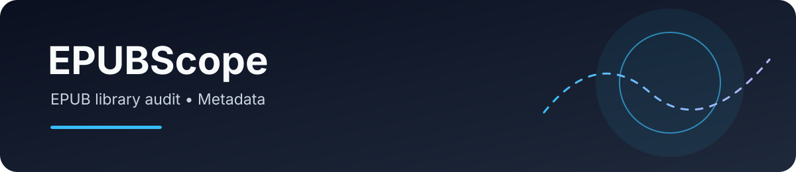

# EPUBScope

<p align="center"></p>

**Know what's inside your ebook library.** EPUBScope audits EPUB 2/3 packages and creates a searchable catalog without uploading books anywhere.

## Features
- Read title, author, language, publisher, identifier and subjects
- Validate EPUB ZIP structure, container and package document
- Check manifest/spine references and navigation metadata
- Detect repeated book titles in a library
- Export reports as JSON or CSV
- Python standard library only

## Run

Python 3.9+; no pip installation:

```bash
python app.py inspect ./books/sample.epub
python app.py scan ./books
python app.py scan ./books --json catalog.json --csv catalog.csv
```

The scan is read-only. EPUB files are opened locally and are never modified or uploaded.

## Notes
This is a practical structural audit, not a complete EPUBCheck replacement. Some advanced EPUB conformance rules are outside its scope.